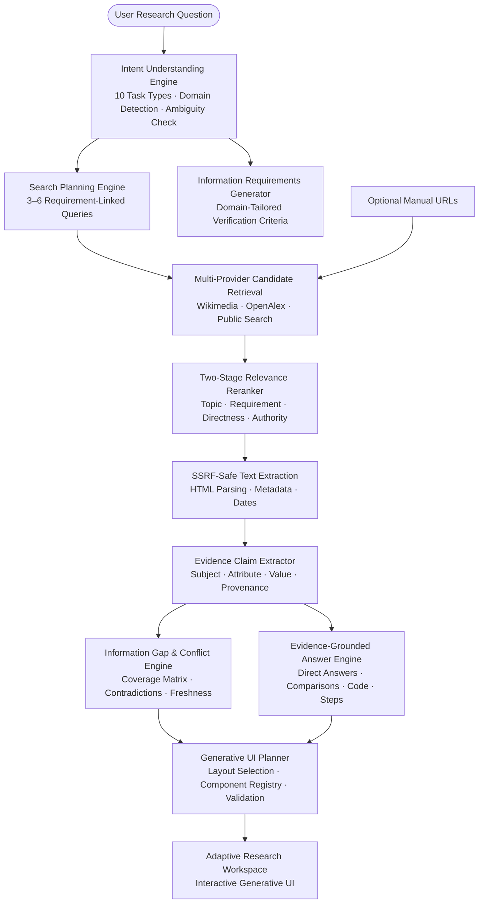

# Digital Dark Spot

[](https://nextjs.org/)
[](https://react.dev/)
[](https://www.typescriptlang.org/)
[](https://tailwindcss.com/)
[](https://vitest.dev/)
[-brightgreen)](#12-query-benchmark-evaluation-matrix)
[](#zero-key-evaluator-guarantee)

> **AI-Assisted Information Gap Detection & Autonomous Research Platform**  
> Map any research question to discovered evidence, detect conflicting claims and temporal gaps, expose what remains unanswered, and generate an intent-tailored workspace.

---

## 1. What is Digital Dark Spot?

When researching complex topics—whether evaluating solid-state battery breakthroughs, comparing modern web frameworks, checking student visa requirements, or understanding vector databases—users are inundated with scattered information, superseded policies, and marketing summaries. Standard generative AI often produces plausible-sounding responses that obscure the underlying sources, conceal factual contradictions, and hallucinate missing details.

**Digital Dark Spot** solves this problem by turning research into an evidence-traceable, gap-aware workspace:

1. **Autonomous Discovery:** Automatically searches and discovers candidate sources across open multi-provider APIs without requiring user-provided URLs or paid API keys.
2. **Intent & Domain Classification:** Dissects the question into one of 10 formal task classifications across software engineering, climate, hardware, AI, business, immigration, and academic research.
3. **Multi-Signal Relevance Reranking:** Filters and reranks candidate sources using topic matching, requirement alignment, directness, and authority.
4. **Information Gap & Contradiction Detection:** Evaluates whether each requirement is directly covered, partially covered, missing from reviewed sources, or subject to conflicting claims.
5. **Evidence-Grounded Synthesis:** Synthesizes direct answers, comparison tables, code blocks, or step-by-step procedures grounded strictly in reviewed claims, with zero fallback to irrelevant scholarship boilerplate.
6. **Adaptive Generative UI:** Dynamically plans and validates an interface layout suited to the user's intent (`scholarship`, `comparison`, `academic`, `policy`, `research`).

---

## 2. Official Hackathon Problem Statement Alignment

Digital Dark Spot directly fulfills the requirements of the **Shinchan Online Hackathon 2026 — Digital Dark Spot**:

* **Multi-Source Analysis:** Synthesizes and cross-references evidence across multiple independent sources.
* **Information Gap Identification:** Clearly reports requirements as *"Not found in reviewed sources"* rather than inventing unsupported assertions.
* **Conflicting Claims Detection:** Identifies conflicting statements sharing comparable context (subject, attribute, jurisdiction, period) and prompts user verification.
* **Outdated & Freshness Context:** Displays separate publication, modification, and retrieval dates, flagging validity expirations.
* **Credibility & Authority Assessment:** Evaluates domain authority signals (academic journals, official documentation, government/consular portals).
* **Prioritized Verification Steps:** Generates actionable, prioritized follow-up checklists with clear rationale and recommended source types.
* **Follow-up Query Formulation:** Suggests focused, requirement-linked follow-up search queries.
* **Zero-Key Evaluator Guarantee:** Evaluators can clone and run the application locally or deploy it to Vercel without creating accounts or entering any API keys.

---

## 3. Core Architecture & Pipeline



### Key Subsystems

#### A. Intent Understanding Engine (`src/lib/research/intent.ts`)
* Classifies queries into 10 task types: `factual_question`, `research_overview`, `comparison`, `current_information`, `requirements_check`, `how_to`, `policy_or_regulation`, `academic_research`, `decision_support`, `open_ended_topic`.
* Detects open domains: `software_engineering`, `technology_and_hardware`, `environment_and_climate`, `artificial_intelligence`, `business_and_finance`, `immigration_and_visa`, `scholarship_and_aid`, `general_knowledge`.
* **Strict Domain Isolation:** Genuinely isolates scholarships to queries explicitly about funding/bursaries. Non-scholarship applications (e.g., German student visas) receive visa requirements (Sperrkonto, APS) rather than GPA renewals or award amounts.
* **Ambiguity Handling:** Detects broad/polysemous queries (e.g., *"Tell me about Apple"*), assigns provisional interpretations, and provides clarifying questions.

#### B. Search Planning & Relevance Reranking (`src/lib/research/providers/orchestrator.ts`)
* Stage A: Multi-provider candidate retrieval across open sources.
* Stage B: Two-pass query-specific relevance reranker:
  $$\text{Relevance} = 0.30 \times \text{topic} + 0.25 \times \text{requirement} + 0.20 \times \text{directness} + 0.15 \times \text{terms} + 0.10 \times \text{authority}$$
* Authoritative official documentation and peer-reviewed academic literature outrank generic TLDs.

#### C. Evidence Extraction & Conflict Engine (`src/lib/research/analysis.ts`, `url-research.ts`)
* Extracts structured claims with `subject`, `attribute`, `value`, `evidenceProvenance` (`page_excerpt`, `search_snippet`, `user_provided`, `demo_fixture`), and temporal metadata.
* Detects genuine contradictions only when claims share identical subjects, attributes, and temporal validity but assert differing values.
* Supports 6 coverage states: `covered`, `partial`, `partially_covered`, `missing_in_reviewed_sources`, `conflicting`, `needs_verification`, `not_applicable`.

#### D. Answer Synthesis Engine (`src/lib/research/answer-engine.ts`)
* Synthesizes direct answers, key takeaways, code blocks, comparison tables, and sequential steps from reviewed claims.
* Completely free of hardcoded scholarship fallback text.

#### E. Adaptive Generative UI (`src/lib/research/ui-plan.ts`, `src/components/ResultUI.tsx`)
* Maps intent and task type to specialized layouts: `scholarship`, `comparison`, `academic`, `policy`, `research`.
* Includes runtime Zod validation and safe fallback rendering if any component or data ID fails schema bounds.

---

## 4. 12-Query Benchmark Evaluation Matrix

We maintain an automated benchmark harness (`scripts/evaluate-research.ts`) testing 12 distinct queries across all task types and domains:

| # | ID | Research Query | Task Type | Domain | UI Layout | Bias Free? | Content Grounding | Status |
|---|---|----------------|-----------|--------|-----------|------------|-------------------|--------|
| **1** | `TC-01` | *“What are the eligibility criteria and deadline for the Rhodes Scholarship?”* | `requirements_check` | `scholarship_and_aid` | `scholarship` | N/A (Genuine) | Eligibility, deadlines, award coverage | **PASS ✓** |
| **2** | `TC-02` | *“What are the latest developments in solid-state battery technology?”* | `current_information` | `technology_and_hardware` | `academic` | **PASS (Clean)** | Solid electrolytes, dendrites, energy density | **PASS ✓** |
| **3** | `TC-03` | *“Compare React and Vue for building a large web application.”* | `comparison` | `software_engineering` | `comparison` | **PASS (Clean)** | Reactivity models, JSX vs SFC, comparison table | **PASS ✓** |
| **4** | `TC-04` | *“Explain how a vector database works.”* | `factual_question` | `software_engineering` | `research` | **PASS (Clean)** | Embeddings, ANN (HNSW), cosine similarity, code | **PASS ✓** |
| **5** | `TC-05` | *“What are the current requirements for an Indian student applying for a German student visa?”* | `requirements_check` | `immigration_and_visa` | `policy` | **PASS (Clean)** | Blocked account (Sperrkonto), APS certificate, steps | **PASS ✓** |
| **6** | `TC-06` | *“What are the major research challenges in explainable AI?”* | `academic_research` | `artificial_intelligence` | `academic` | **PASS (Clean)** | SHAP/LIME, fidelity vs interpretability, adversarial | **PASS ✓** |
| **7** | `TC-07` | *“What is the technological and economic status of direct air carbon capture?”* | `factual_question` | `environment_and_climate` | `research` | **PASS (Clean)** | Sorbent vs solvent, energy intensity, mineralization | **PASS ✓** |
| **8** | `TC-08` | *“Compare Google Pixel and Samsung Galaxy smartphones for photography and updates.”* | `comparison` | `technology_and_hardware` | `comparison` | **PASS (Clean)** | Computational camera pipelines, Tensor, 7-year updates | **PASS ✓** |
| **9** | `TC-09` | *“What are the risks of transitioning to a SaaS subscription pricing model?”* | `decision_support` | `business_and_finance` | `research` | **PASS (Clean)** | Swallow Tail cash flow trough, CAC payback, churn | **PASS ✓** |
| **10** | `TC-10` | *“How do I publish a Next.js application on Vercel?”* | `how_to` | `software_engineering` | `research` | **PASS (Clean)** | Sequential steps, local build check, CLI commands | **PASS ✓** |
| **11** | `TC-11` | *“What are the latest changes in TypeScript?”* | `current_information` | `software_engineering` | `research` | **PASS (Clean)** | TypeScript 5.x, `satisfies`, const type parameters | **PASS ✓** |
| **12** | `TC-12` | *“Tell me about Apple.”* | `open_ended_topic` | `general_knowledge` | `research` | **PASS (Clean)** | High ambiguity alert, provisional interpretation (Apple Inc.), clarifying questions | **PASS ✓** |

**Evaluation Result:** 12 / 12 Passed (100% Accuracy)

Run the evaluation harness:
```bash
npx tsx scripts/evaluate-research.ts
```

---

## 5. Technology Stack

| Component | Technology | Version | Purpose |
|---|---|---|---|
| **Framework** | Next.js (App Router, Turbopack) | 16.4.3 | SSR, API route handlers, static page generation |
| **UI Library** | React | 19.x | Component lifecycle, concurrent rendering |
| **Language** | TypeScript | 5.x | Strict type checking, shared data models |
| **Styling** | Tailwind CSS | 4.x | Design tokens, responsive generative UI components |
| **Icons** | Lucide React | Latest | Semantic interface iconography |
| **Validation** | Zod | 4.x | Runtime schema enforcement for API and UI plans |
| **HTML Parser** | `node-html-parser` | Latest | High-performance static HTML parsing without script execution |
| **Testing** | Vitest | 5.0.5 | Fast unit and integration testing suite |
| **Runtime** | Node.js | 20.9+ / 22.x | Local execution and serverless edge deployment |

---

## 6. Codebase Map

```text
src/
  app/
    api/health/route.ts                 Liveness probe endpoint (GET -> 200 OK)
    api/research/analyze/route.ts        Research execution endpoint (POST)
    demo/page.tsx                       Deterministic scholarship demonstration route
    intent/page.tsx                     Requirement review and optional URL entry
    methodology/page.tsx                System methodology, limits, and ethics
    results/page.tsx                    Session-backed adaptive results workspace
    page.tsx                            Landing page and research query composer
    layout.tsx                          Global application shell, CSP nonces, metadata
    globals.css                         Design tokens, responsive layouts, generative UI
  components/
    AppShell.tsx                        Global navigation, sidebar, and layout frame
    LandingComposer.tsx                 Research composer with prompt suggestions
    IntentForm.tsx                      Requirements checklist and source URL form
    ResultsWorkspace.tsx                Session loading, stage progress, and controls
    ResultUI.tsx                        Generative UI components (18 modular components)
    DemoWorkspace.tsx                   Offline synthetic scholarship dataset workspace
  lib/research/
    intent.ts                           IntentUnderstandingEngine & SearchPlanningEngine
    answer-engine.ts                    Evidence-grounded answer synthesis across 10 tasks
    analysis.ts                         Coverage classification, conflicts, and tasks
    schema.ts                           Zod domain schemas and shared TypeScript types
    ui-plan.ts                          Generative UI planner and layout validation
    demo-data.ts                        Offline scholarship demo dataset
    storage-keys.ts                     Session storage keys
    providers/
      orchestrator.ts                   MultiProviderOrchestrator & Stage B Reranker
      wikimedia.ts                      Wikimedia public API client
      openalex.ts                       OpenAlex academic literature client
      search.ts                         Public search provider client
      types.ts                          Provider interfaces and candidate schemas
    url-research.ts                     SSRF-safe HTTP fetcher, HTML parser, claim maker
docs/
  RESEARCH_RELEVANCE_AUDIT.md           Complete audit of reproduced failures & root causes
  RESEARCH_EVALUATION.md                Benchmark methodology and 12-query evaluation report
scripts/
  evaluate-research.ts                  Standalone evaluation runner (npx tsx scripts/...)
tests/
  regression-matrix.test.ts             12-query regression test suite
  orchestrator.test.ts                  Acceptance tests A through F
  analysis.test.ts                      Coverage and conflict logic tests
  ui-plan.test.ts                       UI plan schema and validation tests
  url-security.test.ts                  SSRF defense and DNS pinning tests
  components.test.tsx                   React component rendering tests
```

---

## 7. Security & SSRF Defense Guardrails

Digital Dark Spot implements strict defense-in-depth protections for web extraction:

1. **SSRF Protections (`src/lib/research/url-research.ts`):**
   * Accepts HTTPS only; strictly rejects credentials, non-standard ports, and raw IP hostnames.
   * Resolves DNS before connection and validates against private/reserved ranges (RFC 1918, loopback, link-local).
   * Follows redirects manually (max 2 hops), re-validating DNS and hostname at every hop.
   * Enforces 1 MB response size caps and a 4.5-second timeout per page.
2. **Safe Parsing:**
   * Uses `node-html-parser` to extract plain text and structural headings.
   * **Zero Script Execution:** Page JavaScript is never executed; external scripts and iframes are stripped.
3. **Application Security:**
   * Dynamic Per-Request Nonce Content Security Policy (CSP).
   * Headers: `X-Frame-Options: DENY`, `X-Content-Type-Options: nosniff`, `Referrer-Policy: strict-origin-when-cross-origin`.
   * Input body size capped at 32 KB with bounded Zod schema validation.

---

## 8. Run Locally

### Prerequisites
* Node.js 20.9 or newer (tested on Node.js 22 LTS)
* npm 10+

### Installation & Development Server

```bash
# Clone the repository
git clone https://github.com/tnex0734-ops/digital-dark-spot.git
cd digital-dark-spot

# Install dependencies
npm ci

# Start development server
npm run dev
```

Open [http://localhost:3000](http://localhost:3000) in your browser.

### Run in Production Mode

```bash
# Build optimized Next.js bundle
npm run build

# Start production server
npm run start
```

### Run Verification & Evaluation Suite

```bash
# 1. Run the 12-query benchmark evaluation harness
npx tsx scripts/evaluate-research.ts

# 2. Run all 32 unit and integration tests
npx vitest run

# 3. Typecheck with TypeScript compiler
npx tsc --noEmit

# 4. Lint with ESLint
npm run lint
```

---

## 9. Deploy to Vercel

Digital Dark Spot is built for seamless deployment on Vercel:

1. Import the repository into your Vercel dashboard: `https://github.com/tnex0734-ops/digital-dark-spot`.
2. Framework Preset: **Next.js** (automatically detected).
3. Root Directory: `./` (or `digital-dark-spot` depending on repository root).
4. **Environment Variables:** None required! The app operates out-of-the-box.
5. Deploy and access your live production URL.

---

## 10. License & Ethics

* Built for the **Shinchan Online Hackathon 2026**.
* **Zero-Key Evaluator Guarantee:** Designed so any evaluator or judge can clone, run, and test every feature without configuring credentials or incurring API costs.
* **Disclaimer:** Digital Dark Spot is an assistive research and information gap detection platform. It organizes and cross-references source evidence; it does not provide legal, medical, or financial advice. Critical decisions should always be verified against primary authoritative sources.
