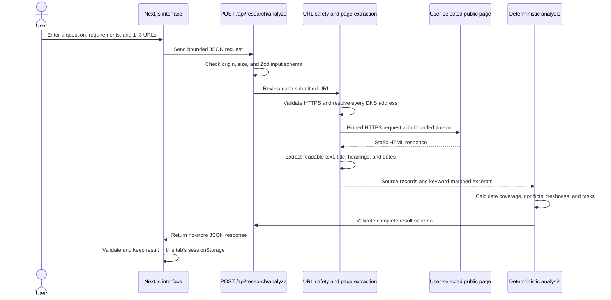
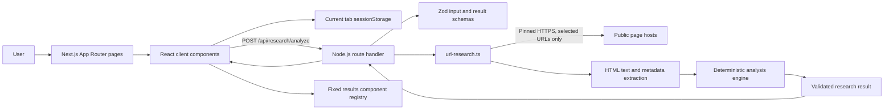

# Digital Dark Spot

**An evidence-first research workspace that shows what a small set of sources supports, what remains unanswered, and what to verify next.**

Digital Dark Spot helps people review a decision or research question against a few pages they choose themselves. It connects each suggested requirement to text found in those pages, keeps the source and its dates visible, and calls out missing, older, or potentially conflicting information.

The product is deliberately transparent about its limits: it uses deterministic templates and text-matching rules, not a live AI model, internet-wide search, or a claim-verification service.

## The problem

Important information is often spread across notices, policies, checklists, and older guidance. A person comparing those pages has to remember which page said what, whether a date applied to the current cycle, and which requirements are still unanswered. A broad summary can make that harder if it hides its sources or sounds more certain than the evidence allows.

Digital Dark Spot makes the review scope explicit. It asks the user to choose the question and the pages, then keeps evidence, gaps, source dates, and follow-up checks together. The goal is to support a careful next step, not make the decision for the user.

## Product goals

- Keep each excerpt attached to the page it came from.
- Make the selected source set and uncovered requirements visible.
- Surface possible conflicts and date context without presenting them as proven errors.
- Give users an editable checklist of requirements and practical verification tasks.
- Keep the demo usable without an account, API key, or third-party network request.
- Minimise retention of user questions and source content.

## Features

### Guided research

1. Enter a question on the landing page.
2. Review suggested requirements and edit, remove, or add items.
3. Supply one to three public HTTPS page URLs.
4. Review the returned excerpts, coverage, possible conflicts, source dates, and next checks.
5. Print the report or clear the research from the current browser tab.

Requirement suggestions are deterministic templates based on the wording of the question. They are prompts for review, not official rules or expert advice. The interface also flags questions that appear to involve a high-impact area so the user can consult authoritative sources and qualified professionals where appropriate.

### Evidence and gap map

Every matched passage is displayed with its source title, link when available, and relevant date context. Each requirement receives one of these scoped statuses:

| Status | Meaning |
| --- | --- |
| **Covered** | At least one excerpt matched the requirement in the reviewed pages. |
| **Partial** | A relevant excerpt was found, but it may not answer the full requirement. |
| **Needs verification** | Evidence was found, but a period or context needs checking. |
| **Possible conflict** | Comparable excerpts differ in value; check them against a current primary source. |
| **Not found in reviewed sources** | No excerpt matched in the selected pages. This does not mean the information does not exist elsewhere. |

The coverage percentage is the share of listed requirements with at least one excerpt. It is not a probability that the answer is correct, a measure of source quality, or a measure of everything available on the internet.

### Date and conflict context

Publication, modification, retrieval, and validity dates are shown separately when the source provides them. An expired validity period or an older publication date is a reason to check the current rule; age alone does not prove that a statement is false or obsolete.

A possible conflict is only suggested when two matched excerpts share the same subject, attribute, unit, jurisdiction, condition, and period but state different values. The result remains a prompt for human verification.

### Verification checklist

Open requirements are converted into prioritised follow-up tasks. The priority label is a transparent triage aid derived from requirement impact, evidence uncertainty, and time sensitivity. It is not a calibrated risk score or a professional recommendation. Users can check items off in the results workspace and reset the checklist.

### Local scholarship demo

Open **Try the demo** in the top bar or visit `/demo`. It loads a complete example immediately, with fictional scholarship records, sample excerpts, an older-cycle deadline, a document-count conflict, missing requirements, and suggested next checks.

The demo makes no network request. All names, excerpts, amounts, and dates are synthetic and are labelled as illustrative; they are not real scholarship guidance.

## How a URL review works

The review flow is intentionally narrow: the app requests only the pages the user submits. It does not search the web, follow ordinary links, or crawl a site.



### Analysis stages

1. **Intent suggestion:** classify the question into a deterministic research category, estimate time sensitivity, and select a small editable requirement template.
2. **Input validation:** enforce a 16 KB request-body limit, one to three URLs, one to twelve requirements, and bounded field lengths.
3. **Safe page retrieval:** validate each URL, resolve all DNS answers, reject any non-public target, and pin the chosen public address for the TLS request. Redirects are followed manually and revalidated.
4. **Text extraction:** accept static `text/html`, remove non-content elements such as scripts and navigation, and extract a bounded amount of text plus page metadata. Page JavaScript is never executed.
5. **Requirement matching:** split extracted text into bounded sentences and use requirement keywords to find candidate excerpts. Each match is explicitly labelled as a text match, not proof that a claim is accurate.
6. **Result construction:** calculate requirement coverage, possible conflicts, source-date context, an evidence-coverage percentage, and verification tasks using deterministic rules.
7. **Validation and display:** validate the result with strict Zod schemas on the server and again in the browser. Render the validated records in a fixed component registry; use the fallback renderer if a UI plan is invalid.

## Architecture

Digital Dark Spot is a single Next.js application. There is no separate database, authentication service, job queue, hosted AI, analytics service, or search provider in this release.



### Request and state boundaries

- The landing question is held in the current tab's `sessionStorage` while the user moves through the workflow.
- The browser sends the question, the selected requirement labels, and the entered URLs to the app's own `/api/research/analyze` route.
- The server requests the submitted URLs. The question is not sent to those page hosts.
- The server processes fetched HTML in memory for that request and returns the extracted result. The application does not write research content to a database or log question text and full URLs.
- The browser stores the result in the same tab's `sessionStorage`. **Clear research** removes the question and result; closing the tab ends that tab's session.
- Hosting providers may still process ordinary infrastructure and request metadata under their own platform policies. Review the selected hosting provider's terms before using sensitive material.

## Technology stack

| Area | Technology | Role |
| --- | --- | --- |
| Web framework | Next.js 16 App Router | Pages, layouts, route handlers, and production server. |
| UI | React 19 and TypeScript | Accessible, typed interfaces and client interactions. |
| Styling | Tailwind CSS 4 with the Turbopack CSS loader | Responsive styling and design tokens. |
| Icons | Lucide React | Interface icons. |
| Validation | Zod 4 | Strict request, research-result, and UI-plan schemas. |
| HTML parsing | `node-html-parser` | Parse static HTML without running page scripts. |
| Unit/component tests | Vitest, Testing Library, jsdom | Test analysis rules, component behavior, and security helpers. |
| Browser tests | Playwright | Test the production app flow and narrow mobile layout. |
| Runtime | Node.js 20.9+ | Local development and server-side URL retrieval. |

## Code map

```text
src/
  app/
    api/health/route.ts                 Liveness endpoint
    api/research/analyze/route.ts        Validated URL-review API
    demo/page.tsx                       Synthetic scholarship demo route
    intent/page.tsx                     Requirement and source selection route
    methodology/page.tsx                User-facing methodology and limits
    results/page.tsx                    Session-backed result route
    page.tsx                            Landing page and research entry point
    layout.tsx                          Shared app shell and metadata
    globals.css                         Responsive design system and styles
  components/
    AppShell.tsx                        Navigation and shared page frame
    LandingComposer.tsx                 Research question composer
    IntentForm.tsx                      Editable requirements and URL form
    ResultsWorkspace.tsx                Session loading, reset, and report view
    ResultUI.tsx                         Evidence, coverage, conflict, and task UI
    DemoWorkspace.tsx                   Bundled example workspace
  lib/research/
    intent.ts                           Intent classification and templates
    url-research.ts                     SSRF-safe fetch, parse, and text matching
    analysis.ts                         Coverage, conflict, freshness, and priorities
    schema.ts                           Zod schemas and shared domain types
    ui-plan.ts                          Fixed component plan and safe fallback
    demo-data.ts                        Fictional scholarship example
    storage-keys.ts                     Versioned sessionStorage keys
  proxy.ts                              Per-request CSP nonce
public/
  digital-dark-spot-logo.png           Site logo and browser icon
tests/
  analysis.test.ts                      Analysis behavior tests
  components.test.tsx                   React component tests
  ui-plan.test.ts                       Result UI plan validation tests
  url-security.test.ts                  URL/DNS safety tests
  e2e/demo.spec.ts                      Playwright demo and mobile flow
```

## Privacy and security

### Source-fetch protections

The public URL-review endpoint is a server-side fetcher, so the user cannot use it to request internal services. It:

- accepts HTTPS URLs only; rejects credentials, unusual ports, IP-literal hosts, localhost/private/reserved addresses, and hostnames with any non-public DNS answer;
- resolves DNS before connecting and pins the selected public address while retaining TLS hostname verification;
- follows at most two redirects manually and repeats URL/DNS validation at every hop;
- accepts only `text/html`, limits each response to 1 MB, and applies a 4.5 second timeout per page;
- accepts up to three pages and fetches at most two at a time;
- sends no browser cookies or authorization headers and does not run page JavaScript;
- enforces a maximum 16 KB API request body and a 15 second route duration.

Pages requiring sign-in, JavaScript execution, unusual encodings, PDFs, or anti-bot access may fail. The app reports failures instead of filling gaps with invented content. Avoid entering URLs that contain access tokens or other secrets: the app server must request the URL you submit.

### Browser and application protections

- Per-request nonce Content Security Policy, `frame-ancestors 'none'`, `X-Frame-Options: DENY`, `X-Content-Type-Options: nosniff`, restrictive referrer and permissions policies, same-origin resource policy, and production HSTS.
- Origin and Fetch Metadata checks on the URL-review API.
- Strict schema validation at API boundaries and before rendering stored results.
- Source text rendered as escaped text. It is not inserted as trusted HTML, executed as code, or treated as instructions.
- No login secrets, API keys, or environment variables are needed or bundled for client code.
- `.env*`, build output, dependency folders, test reports, and local artifacts are excluded through `.gitignore`.

### Public deployment and rate limiting

The endpoint is deliberately bounded but this version has no durable, cross-instance rate-limit store. Before accepting meaningful public traffic, configure a hosting-edge rate limit or WAF and monitor usage. A process-local counter would not provide a consistent limit across serverless instances.

## Methodology and limitations

- The demo is fictional; its apparent rules must not be used for a real application.
- Intent categories and requirement suggestions are deterministic templates, not an LLM's understanding of the question.
- Keyword matches can miss relevant passages or match text that does not fully answer the requirement. Users should inspect the excerpt and source.
- “Not found in reviewed sources” applies only to the selected pages; it says nothing about unreviewed sources.
- Conflict detection compares structured context fields and suggests a possible conflict; it does not resolve which source is authoritative or current.
- A publication or update date does not independently establish current validity. Validity dates are shown when a page provides them.
- Source authority and relevance weights shown in the methodology are provisional and are not calibrated truth scores. This release does not display a numeric source score.
- Priority labels are triage labels, not risk probabilities, professional advice, or a decision recommendation.
- This release does not provide accounts, saved projects, PDF extraction, full-web search, multilingual analysis, durable audit history, or cross-device sync.

Use official primary sources to verify important information. For legal, medical, financial, safety-related, immigration, or other high-impact matters, consult an appropriately qualified professional where needed.

## Run locally

### Requirements

- Node.js 20.9 or newer
- npm (the version bundled with Node.js is fine)
- Network access only if you use URL Research; the bundled demo works without outbound requests.

### Install and start

```bash
npm ci
npm run dev
```

Open [http://localhost:3000](http://localhost:3000). Select **Try the demo** to explore the app without entering a URL. No `.env` file or API key is required.

### Production mode

```bash
npm run build
npm run start
```

The production server defaults to port `3000`. The health endpoint is available at `/api/health` and returns `{"status":"ok"}` when the Node.js route is reachable.

## Development checks

```bash
npm run lint
npm run typecheck
npm run test
npm run build
npm run test:e2e
```

The Playwright suite starts the production server locally. It blocks third-party browser requests and verifies the landing-to-demo flow, synthetic dataset and disclaimer, conflict display, keyboard dismissal of source details, checklist reset, and a narrow mobile viewport.

## Deploy to Vercel

The application is structured for a standard Next.js deployment and requires no environment variables.

1. Import the private GitHub repository `tnex0734-ops/digital-dark-spot` into your Vercel account, or connect your own fork.
2. Use the detected **Next.js** framework preset and keep the repository root as the Root Directory.
3. Leave Environment Variables empty for this release.
4. Deploy, then open the production URL in a private browser window.
5. Check `/`, `/demo`, `/methodology`, and `/api/health`.
6. Confirm the demo works with third-party browser requests blocked.
7. Try URL Research with a small public static HTML page; check that rejected or unreadable pages produce a clear source error.
8. Before substantial traffic, configure rate limiting or a WAF at the hosting edge.

This repository handoff does not itself create a public deployment. After deployment, the public application URL is what makes the app available to users anywhere; the GitHub repository can remain private.

## Repository status

The source repository is private by default. This keeps the implementation and workspace materials out of public view while still allowing a hosting provider to build the app from a connected private repository.
